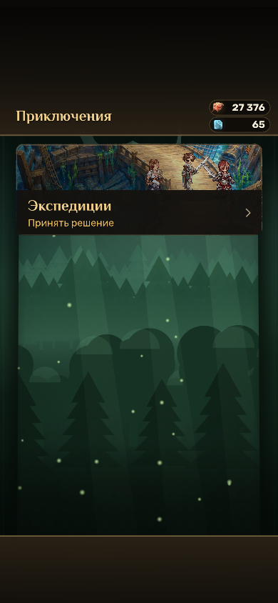
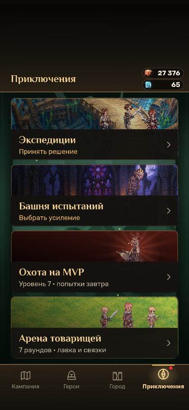

# Ночной независимый аудит интерфейса — 05.10.2026

Проверка начата 04.10.2026 UTC с `main` на `d71207a90c677b74089c12159b367d24bd99da98`.
Продуктовые файлы в QA checkout не менялись. Исправление фонов проверялось отдельно на стабильном сервере
рабочей ветки runtime; SHA-256 двух проверенных модулей сохранены в [summary.json](../REPORTS/2026-10-05-night-ui/summary.json).

## Критический сбой со скриншота: воспроизведён и исправление проверено

При позднем профиле на «Приключениях» оставалась только плитка экспедиций. Другие режимы и кнопки нижней навигации
исчезали; последующие касания ничего не открывали. Получен тот же вид, который прислал владелец:



Причина — выгрузка текстуры живого фона. Старый `backdrops.hold()` оставлял только последний ленивый фон каждого
вида. Плитка Башни использует болотную, костяную или позднюю тему, а следующий баннер Арены запрашивает луг.
В результате источник уже созданного `Image` удалялся до завершения кадра. На WebGL возникал
`Frame.glTexture: Cannot read properties of null`; на Canvas — `Cannot read properties of null (reading 'drawImage')`.
Это общая ошибка жизненного цикла текстур, а не специфический сбой Safari или геометрической маски.

Независимая инструментированная проверка поймала живой `Image` с `texture=skin_bg_battle_crypt`,
`frame=__BASE`, `textureSource=[]`. Канонический прогон с прогретой темой следующего этажа 21 поймал
`skin_bg_battle_swamp` с тем же нарушением. Успешные кадры остановились на счётчике 23; после дополнительной
секунды счётчик остался 23, хотя `game.loop.running` продолжал возвращать `true`. Следовательно, одного этого
флага для проверки живого интерфейса недостаточно.

Исправление удерживает фон, пока его использует хотя бы одно изображение, и освобождает владельца при замене
или уничтожении. После выхода допускается один незанятый фон каждого вида. Исправленный экран:



## Независимая приёмка

Широкая матрица включает 16 экранов: Home, Campaign, Adventure, Tavern, Shop, Quests, Events, Mail, Friends,
Tower, Hunt, Expeditions, Inventory, Achievements, Chronicle и Autobattler.

| Профиль и окружение | Размер | До исправления | После исправления |
| --- | --- | --- | --- |
| Новый профиль, обычный браузер | 390×844 | Экранный проход и навигация работают | 16/16 экранов, без ошибок |
| Поздний профиль, Telegram | 390×844 | Render loop падает после возврата на Adventure | 16/16 экранов и реальные переходы работают |
| Средний профиль, Telegram | 360×640 | Исключений не получено | 16/16 экранов, без ошибок |
| Новый профиль, принудительный WebGL 1 | 360×640 | Исключений не получено | 16/16 экранов, без ошибок |
| Поздний профиль, Canvas | 360×640 | Тот же сбой на возврате Adventure | 16/16 экранов и реальные переходы работают |

Итого после исправления: 80 достигнутых экранов, 88 настоящих указательных кликов, ноль `pageerror` и
`console.error`, ноль неуспешных предусмотренных проверок. Выполнены переходы всех четырёх нижних вкладок,
открытие и закрытие настроек, касания FPS и уменьшения анимации, открытие шансов Таверны и листа предмета Лавки,
переход из Летописи в вечера Таверны, запуск матча Арены и открытие листов правил, соперника, подготовки и связок.
Закрытая Лавка нового профиля явно помечена пропуском; покупка в ней не считается проверенной.

Отдельный ограниченный smoke проверяет следующие этажи Башни **21, 41 и 61**. Для каждого этажа прогревается
его точная тема, затем выполняется вход на Adventure и пять настоящих циклов Heroes → Adventure.
На каждом возврате проверяются четыре видимые интерактивные плитки, четыре кнопки навигации, источник каждого
живого изображения, целевая сцена и рост счётчика успешных кадров.

| Канонический smoke | Результат |
| --- | --- |
| Старый код, Telegram 390×844 | `exit 1`: потерян `skin_bg_battle_swamp`, экран неполный, кадры остановились |
| Исправление, Telegram 390×844 | `exit 0`: 45 записей проверки, 33 настоящих перехода, без потерянных источников |
| Исправление, Canvas 360×640 | `exit 0`: те же 45 записей и 33 перехода, без потерянных источников |

После возврата в Home у каждого из трёх вариантов в обоих renderer оставались ровно **один незанятый battle-фон
и один незанятый map-фон**. Новая защита не заменяет падение неограниченным накоплением фонов.

## Оставшиеся замечания

1. На коротком Telegram-окне 360×640 с верхним отступом 136 CSS px и нижним 34 CSS px поле 1080×1920
   уменьшается до ширины 264,38 CSS px. `TOUCH_COMFORT=132` становится 32,31 CSS px; основной текст заметно мельчает.
   Это воспроизводимая проблема доступности и компактной раскладки. Требуется согласованная адаптация интерфейса
   по высоте, а не увеличение всех зон касания с перекрытием соседних кнопок. Критический ремонт фонов её не решает.
2. Документация старого `ui-atlas-save.ts` обещает среднему профилю позицию 4-6. На проверенном содержимом реальный
   следующий этап — 3-1. Поздний профиль находится перед 6-1, содержит незавершённый выбор благословения Башни и
   использованные попытки Охоты. Прямые снимки этих экранов не подтверждают проверку пустого лобби и старта боя.
3. В этой матрице Friends проверялся с пустым Telegram `initData`: офлайн-состояние, а не авторизованный список
   друзей и облачные операции. Реальные сохранения игроков и Telegram сообщения не затрагивались.

Физический iPhone/Safari здесь недоступен. Все браузерные результаты — настоящий Chromium WebGL 1 либо Canvas;
WebGL использует SwiftShader. Они подтверждают отсутствие остановки рендера и потерянных источников, но не FPS
на устройстве. Изменения графики и новые спрайты в этом проходе не выполнялись.

## Повторить проверку

Нужен заранее установленный глобальный Playwright и Chromium. Скрипты ничего не устанавливают.
`PLAYWRIGHT_MODULE` позволяет указать существующий `index.mjs`, `CHROME_EXECUTABLE_PATH` — существующий браузер;
без этих переменных используются глобальный Playwright и его стандартный Chromium.

Сначала создать частные UI-профили и запустить Vite в отдельном терминале:

```sh
node node_modules/tsx/dist/cli.mjs scripts/ui-atlas-save.ts --saves new,mid,late > /tmp/chronoworld-ui-saves.json
npm run dev -- --host 127.0.0.1 --port 5515 --strictPort
```

Проверка регрессии с дедлайном 240 секунд:

```sh
node scripts/night-ui-cache-repro.mjs --origin http://127.0.0.1:5515 --fixtures /tmp/chronoworld-ui-saves.json --mode telegram --width 390 --out ui-atlas/night-adventure-telegram
node scripts/night-ui-cache-repro.mjs --origin http://127.0.0.1:5515 --fixtures /tmp/chronoworld-ui-saves.json --mode canvas --width 360 --out ui-atlas/night-adventure-canvas
```

Этажи по умолчанию — `21,41,61`, повторений — `5`. Можно изменить их через `--floors` и `--repeat`, либо выбрать
диагностический маршрут `--floors none --route Adventure,Heroes,Adventure --nav Campaign,Home,Heroes,Adventure`.
Прогресс Башни изменяется исключительно в новом частном браузерном контексте для вариантов отображения.
Это **не доказательство прохождения кампании**. Внешние HTTP-запросы блокируются.

Широкая матрица, дедлайн 600 секунд:

```sh
node scripts/night-ui-qa.mjs --origin http://127.0.0.1:5515 --fixtures /tmp/chronoworld-ui-saves.json --out ui-atlas/night-ui
```

Оба скрипта сохраняют `report.json` и снимки. Ошибка страницы, неправильная сцена или превышение дедлайна дают
ненулевой код завершения. Широкая матрица также проверяет недавний успешный рендер; канонический smoke требует
роста счётчика кадров после каждого действия и дополнительно проверяет полноту Adventure, живые источники
и предел незанятых фонов. Важные до/после снимки и компактные результаты сохранены в
[docs/REPORTS/2026-10-05-night-ui](../REPORTS/2026-10-05-night-ui/summary.json).
